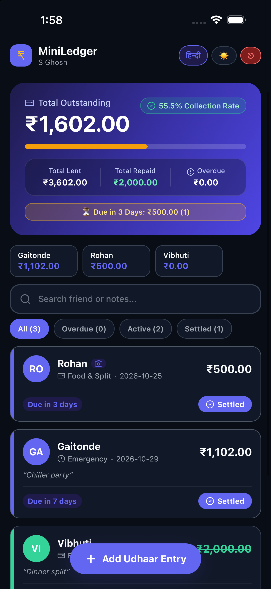
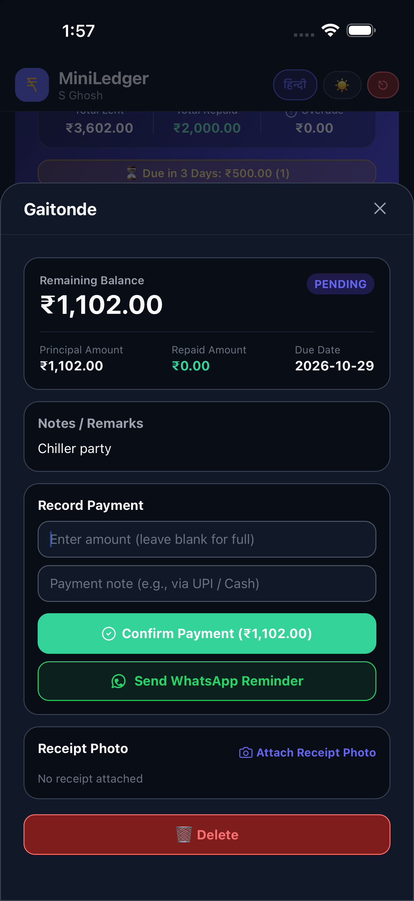
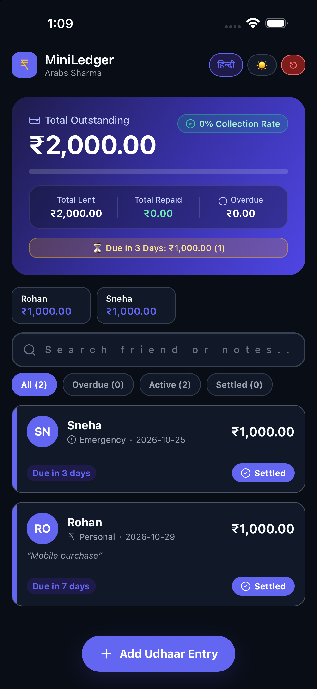
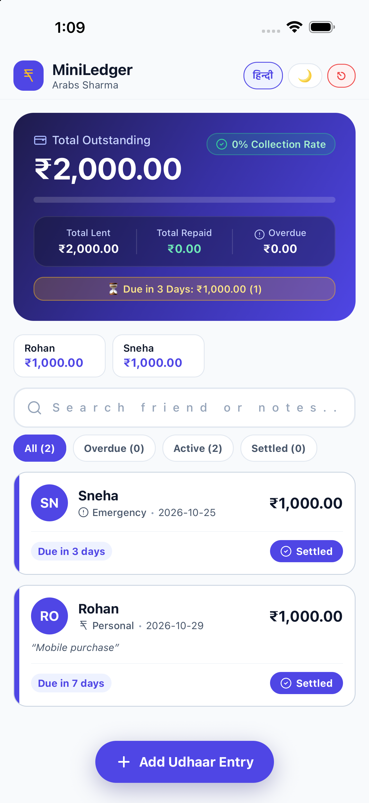
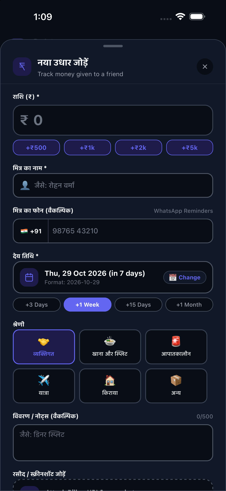
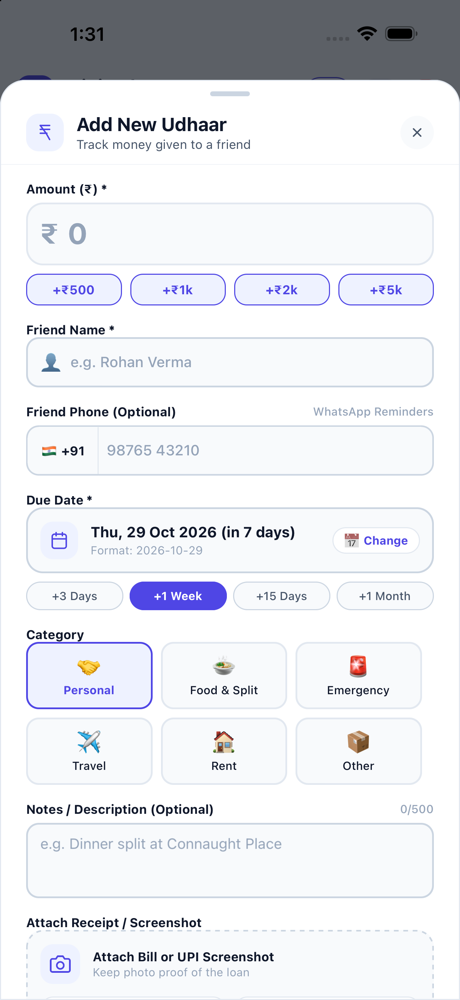
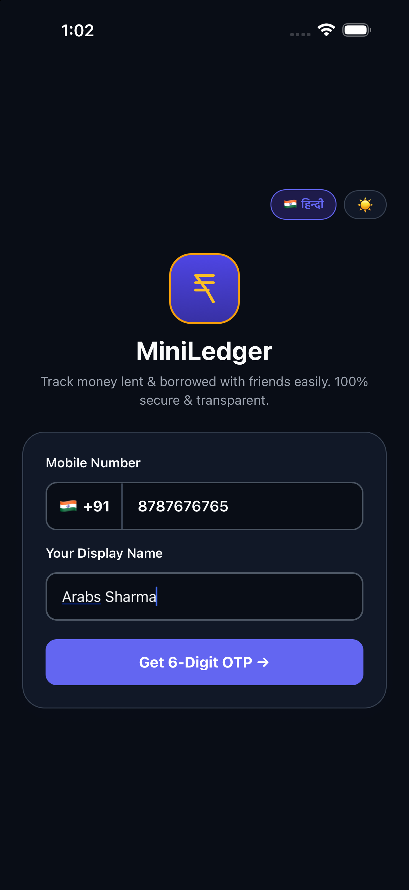
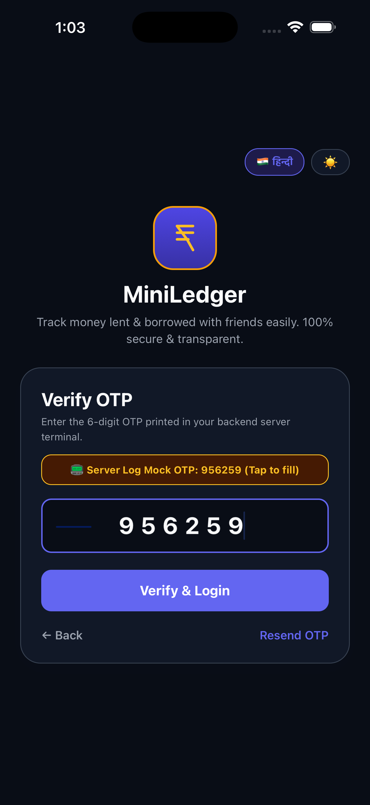
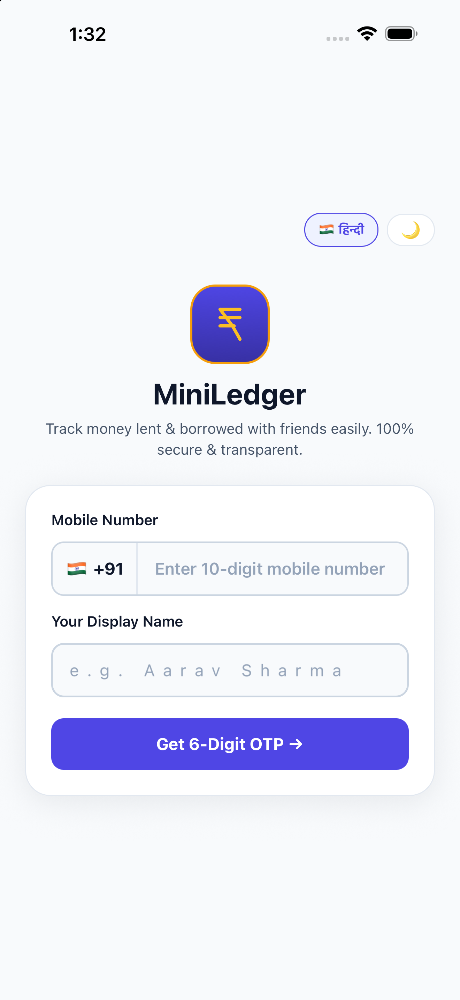
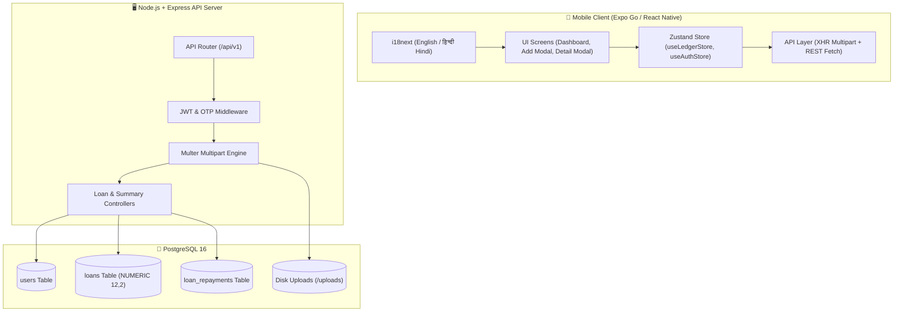

# 🇮🇳 MiniLedger (Bharat Edition)
### *Peer-to-Peer Friend Loan & Khata Tracker for the Modern Indian Economy*

[](https://reactnative.dev/)
[](https://expo.dev/)
[](https://nodejs.org/)
[](https://www.postgresql.org/)
[](https://www.typescriptlang.org/)
[](https://vitest.dev/)
[](LICENSE)

**MiniLedger** is a full-stack, enterprise-grade TypeScript monorepo built specifically for the Indian financial context to effortlessly track money lent to friends, flatmates, and family (*Udhaar / Khata*). Combining a **Node.js + Express + PostgreSQL** backend with a **React Native + Reanimated + Zustand** mobile app (100% Expo Go compatible), MiniLedger delivers **`NUMERIC(12,2)` bank-grade precision**, **side-by-side Dark & Light Neo-Fintech aesthetics**, **bilingual English & हिन्दी (Hindi) localization**, **receipt photo uploads**, and **1-tap WhatsApp payment reminders**.

---

## 📸 App Showcase Gallery

### 1. Active Ledger & Loan Settlement Flow
> **Live Khata Management**: Live dashboard populated with friend loan records (*Gaitonde, Rohan, Vibhuti*), purpose categories, receipt proof indicator, dynamic due-date countdowns, and quick friend filters.
> **Loan Detail & Repayment Modal**: Inspect individual loans, record partial or 100% repayments with UPI notes, view attached photo receipts, and trigger 1-tap WhatsApp payment nudges.

| 📋 Active Ledger with Friend Breakdown | 💳 Loan Detail, Repayments & WhatsApp |
| :---: | :---: |
|  |  |
| *Active loans with due dates, camera receipt indicators & search* | *Flexible partial repayment, UPI notes & WhatsApp reminder trigger* |

<br />

### 2. Dashboard Neo-Fintech Themes (Dark Mode vs. हिन्दी Light Mode)
> Dynamic Collection Rate progress bar, Outstanding Balance hero card, filterable status tabs (*All / Overdue / Pending / Repaid*), overdue indicators, and 1-tap WhatsApp payment nudges.

| 🌙 Royal Indigo Dark Mode | ☀️ Saffron & Mint Light Mode (हिन्दी) |
| :---: | :---: |
|  |  |
| *Active loans, repayment rate (80.8%), and overdue badges* | *पूर्ण हिन्दी स्थानीयकरण: कुल बकाया राशि, वसूली दर, एवं देय सूचियां* |

<br />

### 3. Add Udhaar / Loan Entry Flow
> Hero amount input with quick increment chips (`+₹500`, `+₹1k`, `+₹2k`, `+₹5k`), Indian flag phone badge (`🇮🇳 +91`), quick due-date presets, visual purpose categories (*Personal, Food Split, Emergency, Travel, Rent*), and photo receipt attachment.

| 🌙 Add Loan Sheet (Dark Mode) | ☀️ Add Loan Sheet (Light Mode) |
| :---: | :---: |
|  |  |
| *₹12,000 Rent Khata with due date presets & tactile feedback* | *Clean, distraction-free daylight interface with instant validation* |

<br />

### 4. Authentication & Instant LAN Switcher
> Passwordless Indian mobile authentication (`+91XXXXXXXXXX`), 6-digit expiring OTP verification, and an in-app **LAN API Switcher** that allows physical devices running Expo Go to connect to your local development machine with zero code changes.

| 🌙 Login Screen (Dark Mode) | 🔑 6-Digit OTP Verification | ☀️ Login Screen (Light Mode) |
| :---: | :---: | :---: |
|  |  |  |
| *10-digit Indian phone input & LAN Config* | *Auto-focused 6-digit security code* | *Crisp light mode authentication* |

---

## ⚡ Core Highlights & Engineering Architecture



### 💎 Why MiniLedger Stands Out
1. **Bank-Grade Financial Arithmetic**:
   - Stored in PostgreSQL as `NUMERIC(12, 2)` to completely avoid IEEE-754 floating-point errors (e.g., `0.1 + 0.2 = 0.30000000000000004`).
   - Dynamic computed overdue engine: `isOverdue`, `daysOverdue`, and `daysUntilDue` are generated on-the-fly relative to current date and repayment state.
2. **100% Stable Multipart Upload Architecture**:
   - Engineered with a hybrid upload transport: uses native foreground uploads with an automatic fallback to an `XMLHttpRequest` multipart bridge.
   - Completely immune to WHATWG Fetch Blob incompatibilities on modern React Native (0.74+) and iOS Simulator background session timeouts.
3. **Smooth, Non-Dismissing Keyboard UX**:
   - Uses native iOS `automaticallyAdjustKeyboardInsets` so the amount input card stays anchored, responsive, and never loses focus while typing.
4. **Bilingual By Design**:
   - First-class support for **हिन्दी (Hindi)** and **English** with real-time switching persisted directly into user profile preferences.
5. **WhatsApp 1-Tap Reminders**:
   - Pre-fills culturally respectful, localized payment reminder messages via `whatsapp://send` with exact amounts, due dates, and friendly notes.

---

## 🗂️ Monorepo Structure

```text
bharatledge/
├── images/                             # Real high-resolution app screenshots
│   ├── dashboard-filled.png            # Live active ledger with friend chips & filters
│   ├── dashboard-view-borrow.png       # Loan details, repayment, & WhatsApp modal
│   ├── dashboard-dark.png              # Dark mode dashboard overview
│   ├── dashboard-light-hindi.png       # Light mode dashboard in हिन्दी (Hindi)
│   ├── add-rent-dark.png               # Add loan sheet (Dark mode)
│   ├── add-rent-light.png              # Add loan sheet (Light mode)
│   ├── login-dark.png                  # Mobile login screen (Dark mode)
│   ├── login-light.png                 # Mobile login screen (Light mode)
│   └── login-otp-dark.png              # 6-digit OTP verification screen
├── package.json                        # Root npm workspace configuration
├── tsconfig.base.json                  # Shared strict TypeScript configuration
├── packages/
│   └── backend/                        # Node.js + Express + PostgreSQL + TypeScript API
│       ├── .env.example                # Sample environment configuration
│       ├── package.json
│       ├── tsconfig.json
│       ├── src/
│       │   ├── app.ts                  # Express application setup & middleware
│       │   ├── server.ts               # HTTP bootstrap & LAN IP printer
│       │   ├── config/env.ts           # Zod-validated environment config
│       │   ├── db/
│       │   │   ├── pool.ts             # PostgreSQL connection pool & migrations
│       │   │   └── schema.sql          # DDL tables & indexes
│       │   ├── controllers/            # Auth, loan, and summary business logic
│       │   ├── middleware/             # Auth guards & Multer file filter
│       │   ├── routes/index.ts         # REST API routes
│       │   └── validators/schemas.ts   # Zod request validators
│       └── tests/api.test.ts           # Vitest + Supertest integration suite
└── apps/
    └── mobile/                         # Expo Go (React Native 0.86 + Reanimated 4)
        ├── app.json                    # Expo project configuration
        ├── App.tsx                     # Safe Area & Root Navigator
        ├── package.json
        ├── tsconfig.json
        └── src/
            ├── theme/                  # Colors, typography, spacing, and ThemeContext
            ├── i18n/                   # English & Hindi translation dictionaries
            ├── components/             # Reusable cards, hero summaries, & SVG icons
            ├── screens/
            │   ├── DashboardScreen.tsx # Main ledger view with filters & stats
            │   ├── AddLoanModal.tsx    # Bottom sheet to track money lent
            │   ├── LoanDetailModal.tsx # Detailed view, partial repayments, receipt
            │   └── LoginScreen.tsx     # Phone + OTP authentication & API modal
            ├── store/                  # Zustand state management
            └── services/api.ts         # Resilient networking & multipart upload service
```

---

## 🚀 Quickstart Guide

### Prerequisites
* **Node.js**: `>= 18.0.0`
* **npm**: `>= 9.0.0`
* **PostgreSQL**: `>= 14` running locally or via Docker
* **Expo Go**: Installed on iOS/Android or Xcode / Android Studio Simulator

### 1. Clone & Install Dependencies
```bash
git clone https://github.com/your-username/bharatledge.git
cd bharatledge

# Install dependencies across all workspaces
npm install

# Generate app icons & splash screens
npm run prepare:assets
```

### 2. Configure & Start PostgreSQL Database
```bash
# Option A: Local PostgreSQL
psql -U postgres -c "CREATE DATABASE miniledger;"

# Option B: Docker
docker run --name miniledger-pg \
  -e POSTGRES_USER=postgres \
  -e POSTGRES_PASSWORD=postgres \
  -e POSTGRES_DB=miniledger \
  -p 5432:5432 -d postgres:16-alpine
```

Copy the environment file:
```bash
cp packages/backend/.env.example packages/backend/.env
```

### 3. Run Backend Automated Tests & Start Server
```bash
# Run unit & API integration tests (14 passed)
npm run test:backend

# Start backend server with live reload & DB schema migration
npm run dev:backend
```

The server will log your ready endpoints:
```text
╔══════════════════════════════════════════════════════════════════╗
║        🇮🇳 MINILEDGER (BHARAT EDITION) BACKEND SERVER READY       ║
╠══════════════════════════════════════════════════════════════════╣
║  🌐 Local URL       : http://localhost:4000/api/v1               ║
║  📱 Expo Go LAN URL : http://192.168.1.10:4000/api/v1            ║
║  🖼️  Receipts Dir    : packages/backend/uploads/                   ║
╚══════════════════════════════════════════════════════════════════╝
```

### 4. Start the Expo Mobile App
In a separate terminal:
```bash
npm run dev:mobile
```

* **iOS Simulator**: Press `i` to launch directly in iOS Simulator.
* **Android Emulator**: Press `a` to launch in Android Emulator.
* **Physical Device (Expo Go)**: Scan the QR code. If connecting to a physical phone, tap **`⚙️ API`** on the Login screen and set the **Expo Go LAN URL** printed in your backend terminal.

---

## 🔌 REST API Reference & cURL Playbook

Base URL: `http://localhost:4000/api/v1`

### 1. Request OTP
```bash
curl -X POST http://localhost:4000/api/v1/auth/request-otp \
  -H "Content-Type: application/json" \
  -d '{"phone": "9876543210"}'
```
*Response prints a formatted OTP box in the backend terminal:*
```text
╔══════════════════════════════════════════════════════════════╗
║           🔐 MINILEDGER (BHARAT) - MOCK OTP DISPATCH         ║
╠══════════════════════════════════════════════════════════════╣
║  📱 Phone Number : +919876543210                           ║
║  🔑 6-Digit OTP  : 123456                                  ║
╚══════════════════════════════════════════════════════════════╝
```

### 2. Verify OTP & Obtain JWT
```bash
curl -X POST http://localhost:4000/api/v1/auth/verify-otp \
  -H "Content-Type: application/json" \
  -d '{
    "phone": "9876543210",
    "otp": "123456",
    "displayName": "Aarav Sharma",
    "preferredLanguage": "en"
  }'
```

### 3. Add a New Loan Entry (Multipart with Receipt Photo)
```bash
curl -X POST http://localhost:4000/api/v1/loans \
  -H "Authorization: Bearer <TOKEN>" \
  -F "friendName=Vikram Patel" \
  -F "friendPhone=9876543211" \
  -F "amount=12000" \
  -F "dueDate=2026-11-15" \
  -F "category=RENT" \
  -F "notes=Apartment maintenance advance" \
  -F "receipt=@/path/to/bill.jpg"
```

### 4. Record a Partial Repayment
```bash
curl -X PATCH http://localhost:4000/api/v1/loans/<LOAN_ID>/repay \
  -H "Authorization: Bearer <TOKEN>" \
  -H "Content-Type: application/json" \
  -d '{
    "amount": 4000,
    "note": "Paid via Google Pay UPI"
  }'
```

### 5. Fetch Ledger Summary
```bash
curl -X GET http://localhost:4000/api/v1/summary \
  -H "Authorization: Bearer <TOKEN>"
```

---

## 🛠️ Tech Stack & Monorepo Packages

| Area | Technologies | Details |
| :--- | :--- | :--- |
| **Mobile Runtime** | React Native `0.86.3`, Expo SDK `57.0.31` | Fast Refresh, Hermes Engine, iOS + Android |
| **Animation & Touch** | React Native Reanimated `4.5.1`, Expo Haptics | Quad/Cubic timing curves, tactile feedback |
| **State & Networking**| Zustand `5.0.1`, Native XHR Multipart | Lightweight reactive state, zero-overhead sync |
| **Internationalization**| `i18next`, `react-i18next` | Instant runtime English ⇄ हिन्दी (Hindi) switching |
| **Backend Framework** | Node.js `20+`, Express `4.21`, TypeScript `5.6` | Modular layered MVC architecture |
| **Database** | PostgreSQL `16`, `pg` Pool | `NUMERIC(12,2)` precision, ACID transactions |
| **File Storage** | Multer Disk Storage | Auto-sanitization, MIME-type verification, up to 5MB |
| **Testing** | Vitest `2.1.9`, Supertest `7.0` | 14 automated unit, validation, and integration tests |

---

## 📄 License
This project is open-source and licensed under the **MIT License**.